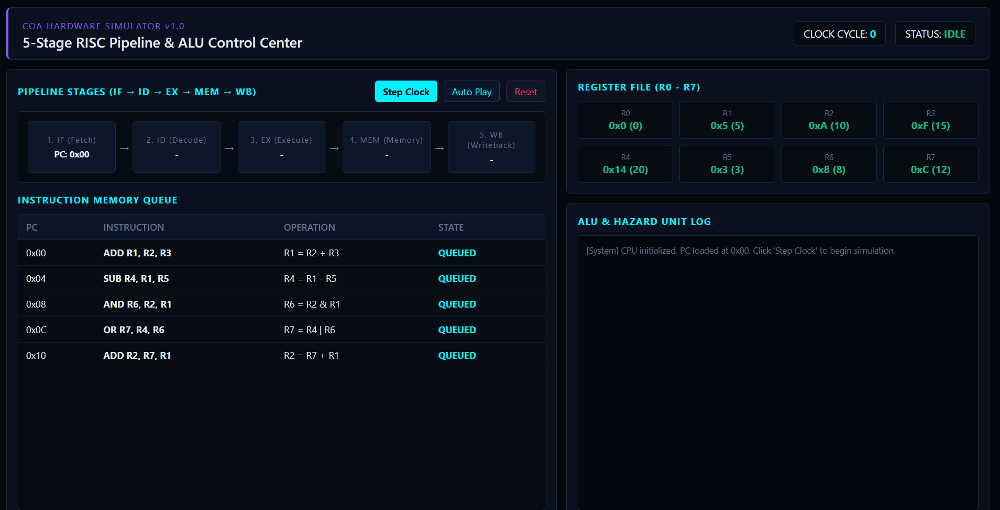

# 🖥️ CPU Pipeline & Instruction Fetch Simulator

An interactive, browser-based 5-stage RISC pipeline simulator built for Computer Organization & Architecture (COA) learning and visualization.

---

## 🚀 Features & Status

| Feature / Module | Description | Status |
| :--- | :--- | :--- |
| **5-Stage Datapath** | Visualizes IF, ID, EX, MEM, and WB stages dynamically | ✅ Done |
| **Instruction Memory Queue** | Tracks program counter (PC) and instruction execution states | ✅ Done |
| **Register File HUD** | Real-time register values update (R0 - R7) | ✅ Done |
| **Step / Auto-Play Clock** | Manual step control or automated simulation clock | ✅ Done |

---

## 🛠️ Tech Stack
* **Frontend:** HTML5, CSS3, Vanilla JavaScript (ES6+)
* **Tooling:** VS Code, Live Server, Git & GitHub

---

## ⚙️ Getting Started & Installation

To run this project locally:

1. Clone the repository:
   ```bash
   git clone [https://github.com/rabin-creator/WebDev-FullCourse.git](https://github.com/rabin-creator/WebDev-FullCourse.git)
   
  