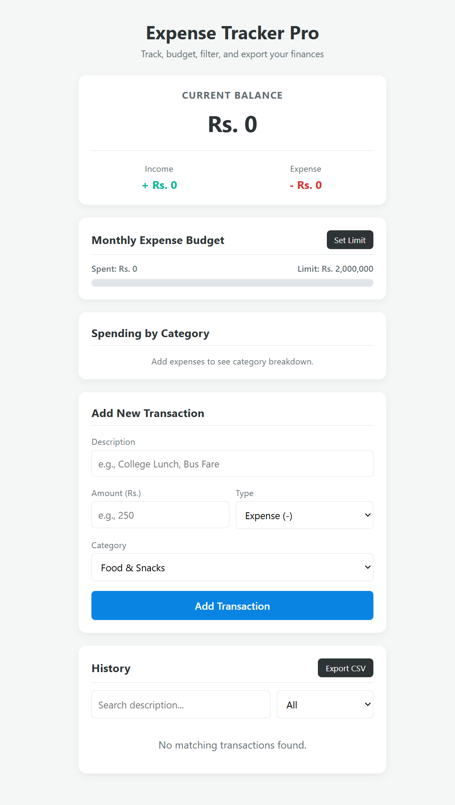

# 💰 Expense Tracker Pro

<p align="center">
  
  
  
  
</p>

A sleek, responsive, and feature-rich personal finance dashboard built with vanilla web technologies. Designed for seamless local execution with zero complex setup or framework dependencies.

---

## 🌟 Key Features

* **📊 Real-Time Financial Dashboard:** Automatically calculates current net balance, total incoming funds, and total expenses instantly upon submission.
* **🎯 Dynamic Monthly Budgeting:** Set a custom monthly expense limit accompanied by a real-time progress bar that dynamically shifts colors (`Green` ➔ `Orange` ➔ `Red`) and displays warning notices when budget limits are breached.
* **📈 Category Analytics:** Visual breakdown bars computing category-wise percentage distribution (*Food & Snacks*, *Transport*, *Bills*, *Study*, etc.).
* **✏️ Full CRUD Functionality:** Add entries, load existing records back into the form for seamless inline editing, or delete inaccurate transactions on the fly.
* **🔍 Search & Filtering:** Instantly query descriptions by keywords or filter your feed by *All*, *Income Only*, or *Expense Only*.
* **💾 Persistent Client Storage:** Utilizes browser `localStorage` to ensure your financial records remain intact across page reloads and browser sessions.
* **📥 CSV Data Export:** Export your entire ledger history into a spreadsheet-ready `.csv` file with a single click.

---

## 📂 Project Structure

This project follows clean separation-of-concerns principles:

```text
expense-tracker/
│
├── expense-tracker.html   # Semantic layout structure & interface markup
├── expense-tracker.css    # Modern styling, custom CSS variables, & responsive design
└── expense-tracker.js     # Core app logic, state management, & browser storage sync
```

---

## 🚀 Getting Started & Installation

Follow these quick steps to get the project running locally on your machine using **VS Code**:

1. **Clone or Download** this repository to your local machine.
2. Open the project folder inside **VS Code**.
3. Ensure all three core files (`expense-tracker.html`, `expense-tracker.css`, `expense-tracker.js`) reside in the **same root directory**.
4. *(Recommended)* Install the **Live Server** extension from the VS Code Marketplace.
5. Right-click on **`expense-tracker.html`** and select **Open with Live Server**.

---

## 💡 How to Use

1. **Set Your Budget:** Click the **Set Limit** button in the budget card to specify your monthly financial cap.
2. **Log Transactions:** Enter a title description, amount, type (*Income* or *Expense*), and select a category, then click **Add Transaction**.
3. **Edit or Correct:** Click the **✏️ Edit** action icon next to any history item to instantly repopulate the form for quick corrections.
4. **Export Ledger:** Click **Export CSV** in the history section to back up your expense data locally.

---

## 🛠️ Built With

* **HTML5:** Structuring clean, accessible UI components.
* **CSS3:** Custom variables, flexbox layouts, smooth transitions, and responsive styling.
* **JavaScript (ES6+):** DOM manipulation, array higher-order methods, and `localStorage` persistence.

---

## 📄 License

Distributed under the **MIT License**. See `LICENSE` for more information.

---

<p align="center">
  Built with ❤️ by a passionate developer 'Rabin'. Star ⭐ this repository if you found it useful!
</p>
